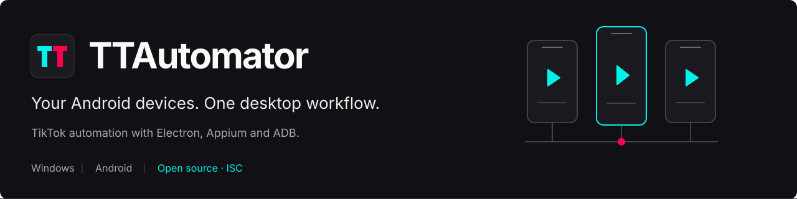
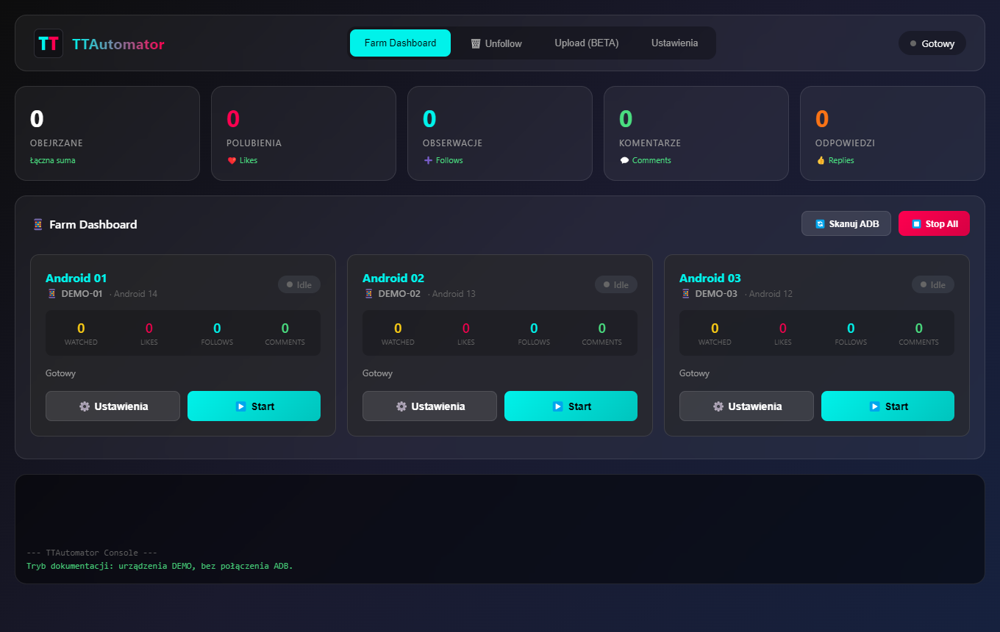
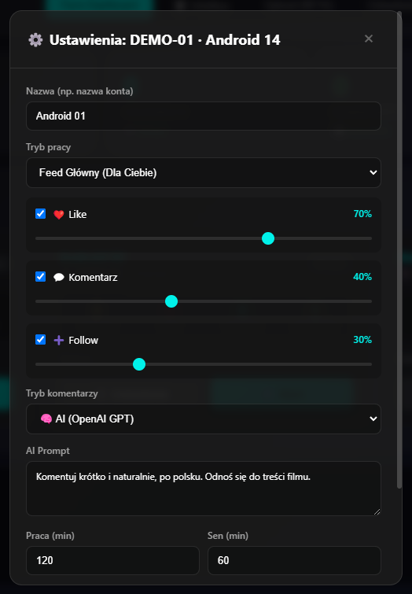
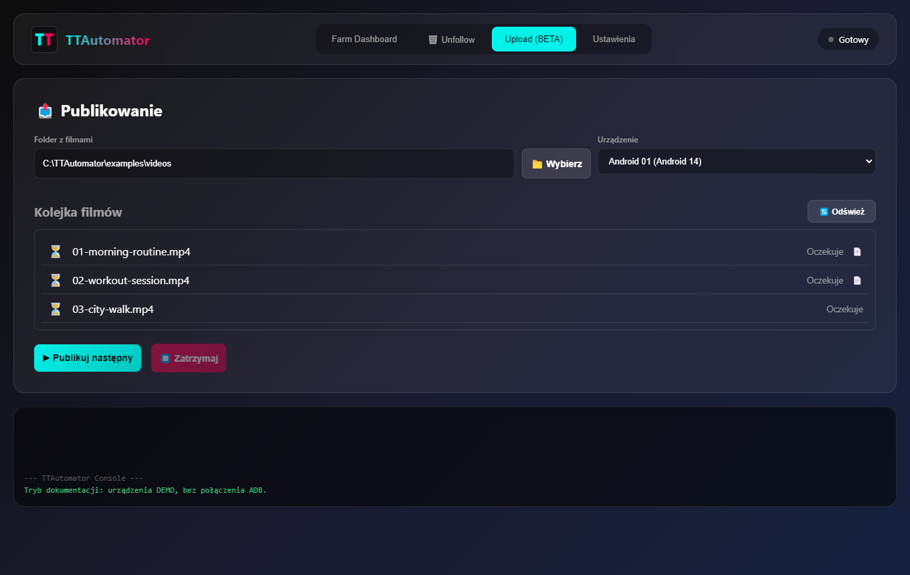

[](https://github.com/dawidmostorski/TTAutomator/actions/workflows/check.yml)
[](LICENSE)
[](#requirements)

An open source Windows desktop application for automating TikTok on Android phones through **Electron, Appium, UiAutomator2 and ADB**. The interface is currently in Polish.

**[Quick start](#quick-start)** · [Screenshots](#screenshots) · [Windows build](#development-and-windows-build) · [Instrukcja po polsku](INSTALACJA.md)

## Screenshots

The current Electron interface, rendered with demo devices and example filenames. All counters start at zero; no real account data or device IDs are shown.



<details>
<summary><strong>Per-device settings</strong> — interaction probabilities, comment prompts and calibration</summary>

Each phone has its own settings. Configure feed, hashtag or reply mode, choose AI or static comments, and adjust work/sleep cycles and screen coordinates.



</details>

<details>
<summary><strong>Video publishing</strong> — a local folder, a device and a publishing queue</summary>

Pick a folder of videos and publish the next item. Matching text files supply descriptions and hashtags; the queue marks which videos have a configuration file.



</details>

## Features

| Workflow | What you can configure |
| --- | --- |
| **Device management** | Separate phone settings, coordinate calibration, repeating work/sleep cycles and session recovery. |
| **Feed and hashtags** | Main feed or hashtag search, with configurable probabilities for likes, follows and comments. |
| **Comments and replies** | OpenAI-generated or static comments, custom prompts, and screenshot-based analysis for replies. |
| **Video publishing** | Local video queue, transfer to Android, descriptions and hashtags from matching `.txt` files. |
| **Diagnostics** | UI inspection and calibration scripts for changes in TikTok's layout. |

## Requirements

- Windows 10/11, an Android phone with TikTok installed, USB debugging enabled, and an authorized USB connection.
- Node.js and npm available on `PATH` (development checks use Node.js 24).
- Android SDK Platform Tools (`adb`), with `ANDROID_HOME` pointing to the parent of `platform-tools`.
- An Appium server with the UiAutomator2 driver, installed separately.
- An OpenAI API key. The current bot initializes the OpenAI client even in static comment mode. AI features make paid API requests.

## Quick start

Run in PowerShell:

```powershell
git clone https://github.com/dawidmostorski/TTAutomator.git
cd TTAutomator
npm ci
Copy-Item .env.example .env
Copy-Item device_configs.example.json device_configs.json
Copy-Item comments_config.example.json comments_config.json
```

For a fresh clone, edit `.env` and set `OPENAI_API_KEY`. The copy commands above are for initial setup; preserve any existing personal configuration when updating.

Install Appium separately if needed:

```powershell
npm install --global appium
appium driver install uiautomator2
adb devices
appium
```

Keep the Appium terminal open. In another terminal, run:

```powershell
npm start
```

Appium is expected at `localhost:4723`. Scan for devices in the dashboard, configure a phone and calibrate the controls before starting it.

See [the Polish installation guide](INSTALACJA.md) for Android SDK setup and [the calibration guide](KALIBRACJA.md) for selector and coordinate diagnostics.

## Publishing videos

Select a folder in the Upload tab, choose a phone and click **Publikuj następny** to publish the next pending video. A file such as `video.mp4` can have a matching `video.txt`:

```text
OPIS: Krótki opis filmu
HASHTAGI: #przyklad #video
```

See [examples/video.txt](examples/video.txt). If no description is provided, AI generates one using the **filename**, rather than analyzing the video. The current publishing flow uses fixed screen coordinates and assumes the newest gallery item is the transferred video.

## Development and Windows build

```powershell
npm run check
npm run build
```

`check` validates JavaScript syntax without connecting to a phone. GitHub Actions also checks syntax and builds the Windows application. This is not an end-to-end device test suite.

To regenerate the documentation screenshots without connecting to a phone:

```powershell
npm run docs:screenshots
```

See [the visual assets guide](docs/branding.md) for the demo data and image sources.

The build is written to `dist/TTAutomator-win32-x64/TTAutomator.exe`. Copy your own `.env` next to the executable before running it. Node.js, ADB and a running Appium server are still required: the desktop app launches its workers with the external `node` command.

The build includes an explicit list of application files and production dependencies. It excludes local credentials, device configurations, history, screenshots, logs, backups and previous builds. Build before running the packaged application; rebuilding replaces its output directory, including runtime settings stored there.

## Project structure

| Path | Purpose |
| --- | --- |
| `gui/main.js` | Electron entry point, device settings and worker processes |
| `gui/preload.js` | IPC bridge |
| `gui/renderer.js`, `gui/index.html` | Dashboard and controls |
| `bot.js` | Feed, tags, interactions and recovery |
| `ai.js` | Comment generation and screenshot analysis |
| `publisher.js` | Video transfer and publishing |
| `unfollow.js`, `db.js` | Unfollow flow and JSON action history |
| `debug_spy.js`, `spy.js`, `inspector.js` | UI diagnostics |
| `test_add_menu.js` | Manual device diagnostic; it performs real UI actions |
| `scripts/` | Syntax checks and distribution packaging |

## Current limitations

- TikTok UI changes and different phone layouts can require calibration or selector updates.
- Some actions report success based on navigation or timing, without verifying the final result on TikTok.
- JSON history and comment configuration are shared between worker processes; concurrent device runs may overwrite each other's data.
- Do not run feed automation, unfollow and uploading simultaneously on the same phone; there is currently no shared device lock.
- The upload queue is kept in memory. Automatic publishing schedules, music selection, location and mentions are not implemented in the publishing flow.

## Configuration and privacy

`.env`, `device_configs.json`, `comments_config.json`, `history.json`, `visited.json`, logs and local screenshots are excluded from Git. Only neutral example configurations are published. Do not include credentials, device IDs or personal data in issues or pull requests.

When AI features are used, video text or comment screenshots are sent to OpenAI. Use the tool only with accounts and devices you control, and follow the applicable platform rules. TTAutomator is an independent project and is not affiliated with TikTok or ByteDance.

## Contributing

Issues and pull requests are welcome. Run `npm run check`, describe your changes and mention whether you tested them on a phone. For UI automation fixes, include the relevant TikTok screen and Android version, with private information removed. Keep personal configuration and generated output out of commits.

## License

[ISC](LICENSE).
